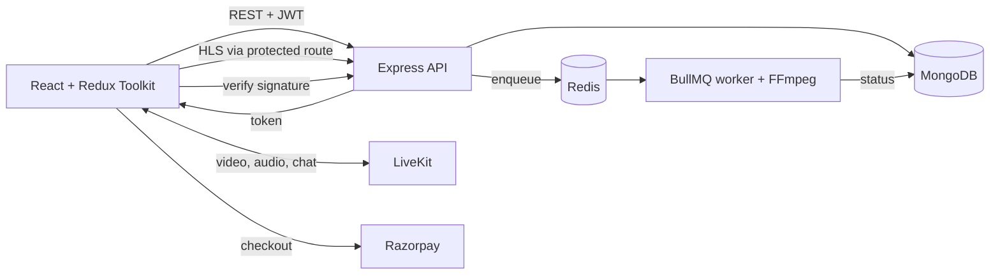

# Learning Management System with Live Classes

A full online school: courses, HLS video lessons, quizzes with auto-grading, live classes with chat, PDF certificates, payments, and instructor earnings.

**Live demo**
- App: https://lms-project-chi-woad.vercel.app/
- API health: https://lms-project-7pkg.onrender.com/api/health

> The API runs on a free tier and sleeps when idle. The first request can take up to a minute.

## Screenshots

| | |
|---|---|
|  |  |
|  |  |
|  |  |
|  |  |
|  |  |
|  |  |

## Tech stack

| Layer | Technology |
|---|---|
| Frontend | React (Vite), Redux Toolkit, React Router, Tailwind, hls.js, Recharts |
| Backend | Node.js, Express 5, MongoDB (Mongoose) |
| Queue | BullMQ + Redis |
| Video | FFmpeg (HLS, 360p and 720p), served through a protected stream route |
| Live classes | LiveKit (WebRTC SFU) with built-in chat |
| Payments | Razorpay (test mode) |
| Certificates | PDFKit + QRCode |
| Tests | Jest + Supertest |

> **Stack note:** The brief I worked from lists the MERN stack with Redux Toolkit, so this project uses MongoDB (Mongoose) and JavaScript, with Recharts for charts. Docker is used for local MongoDB and Redis and for the API image.

## Features

| Feature | How it works |
|---|---|
| Roles | Student, instructor, admin. Role guards on every route, ownership checks on course edits |
| Courses and lessons | Draft and publish workflow, search, category filter, pagination |
| Video upload | Instructor uploads, API returns 202 immediately, a BullMQ worker runs FFmpeg and creates an adaptive HLS ladder. Status updates live in the UI |
| Protected streaming | Every playlist and segment request goes through a JWT and enrollment check |
| Quizzes | Server-side grading. Correct answers are never sent to students before submission |
| Progress | Lesson completion with idempotent updates, progress bar in My Learning |
| Live classes | Instructor schedules, starts and ends a class. Students join with a token that only allows subscribing and chat, not publishing |
| Certificates | Issued at 100% progress with all quizzes passed. PDF has a QR code that opens a public verify page |
| Payments | Server creates the order with the price from the database, signature is verified with HMAC-SHA256 before enrollment |
| Earnings | Instructor dashboard with totals, monthly chart, per-course sales, and a configurable platform fee |
| Admin panel | Platform stats, user search, role change, user delete, course publish and delete |

## Architecture



More diagrams (video pipeline, payment flow) and the design decisions table are in [Docs/architecture.md](Docs/architecture.md).

## Project structure

```
FS-03/
├── server/
│   ├── src/
│   │   ├── config/        db, redis, paths
│   │   ├── models/        User, Course, Lesson, Enrollment, Quiz, Attempt, LiveClass, Payment
│   │   ├── controllers/
│   │   ├── routes/
│   │   ├── middleware/    auth, access, upload
│   │   ├── queues/        video.queue.js
│   │   ├── workers/       video.worker.js
│   │   ├── services/      ffmpeg, certificate, payment
│   │   ├── app.js
│   │   └── server.js
│   ├── seed/
│   ├── test/
│   ├── Dockerfile
│   └── .env.example
├── client/
│   └── src/  app, features, pages, components, api, utils
├── Docs/     architecture.md, api.md, test-results.md, screenshots/
└── docker-compose.yml
```

## Run locally

**Requirements:** Node 20+, Docker, FFmpeg on PATH (`ffmpeg -version`), a LiveKit Cloud project, a Razorpay test account.

```bash
# 1. MongoDB and Redis
docker compose up -d

# 2. Backend
cd server
cp .env.example .env        # Windows CMD: copy .env.example .env
npm install
npm run seed
npm run dev                 # terminal A
npm run worker              # terminal B

# 3. Frontend
cd ../client
cp .env.example .env
npm install
npm run dev                 # http://localhost:5173
```

### Environment variables (`server/.env`)

| Variable | Purpose |
|---|---|
| `PORT` | API port (default 5000) |
| `MONGO_URI` | MongoDB connection string |
| `REDIS_URL` | Redis URL (`rediss://` for hosted TLS Redis) |
| `JWT_SECRET` | Long random string |
| `CLIENT_URL` | Allowed frontend origin(s), comma separated |
| `RUN_WORKER` | `true` runs the video worker inside the API process (single free instance) |
| `LIVEKIT_URL`, `LIVEKIT_API_KEY`, `LIVEKIT_API_SECRET` | LiveKit project keys |
| `RAZORPAY_KEY_ID`, `RAZORPAY_KEY_SECRET` | Razorpay test keys |
| `PLATFORM_FEE_PERCENT` | Platform share of each sale (default 20) |
| `ADMIN_PASSWORD` | Password used for the admin account by the seed script |

`client/.env`: `VITE_API_URL=http://localhost:5000/api`

### Demo accounts (local seed only)

| Role | Email | Password |
|---|---|---|
| Admin | admin@lms.com | value of `ADMIN_PASSWORD` (default `admin123` locally) |
| Instructor | rohit@lms.com | teacher123 |
| Student | aman@lms.com | student123 |

Razorpay test card: `6527 6589 0000 1005`, any future expiry, any CVV. UPI: `success@razorpay`.

## Tests

```bash
cd server
npm test
```

Uses a separate `lms_test` database and refuses to run on any other. Results and performance numbers are in [Docs/test-results.md](Docs/test-results.md).

## Documentation

- [Architecture and design decisions](Docs/architecture.md)
- [API reference](Docs/api.md)
- [Test results and performance](Docs/test-results.md)
- [Reflection](Docs/reflection.md)

## Deployment

| Part | Service |
|---|---|
| Frontend | Vercel (root directory `FS-03/client`) |
| API and worker | Render, Docker (root directory `FS-03/server`, FFmpeg in the image) |
| Database | MongoDB Atlas M0 |
| Queue | Upstash Redis |

## Known limitations

- **No CloudFront.** The project required it, but I did not have an AWS account, so video is delivered through an authenticated stream route on the API. The delivery code is isolated in one route, so a CDN with signed URLs can replace it.
- **Video storage is local disk.** On the free Render instance the disk is temporary, so uploaded videos do not survive a restart. Local runs are not affected. The next step is an S3-compatible bucket.
- Certificate PDFs use a built-in Latin font, so non-Latin names do not render.
- Live class chat is not saved after the class ends.
- No Razorpay webhook, so a user who closes the tab right after paying relies on the client verify call.
- JWT is stored in localStorage; an httpOnly cookie would be safer.
- No automated frontend tests.

## Next steps

S3 + CloudFront with signed URLs, Razorpay webhook, persisted chat, Unicode certificate fonts, httpOnly cookie auth, frontend tests.